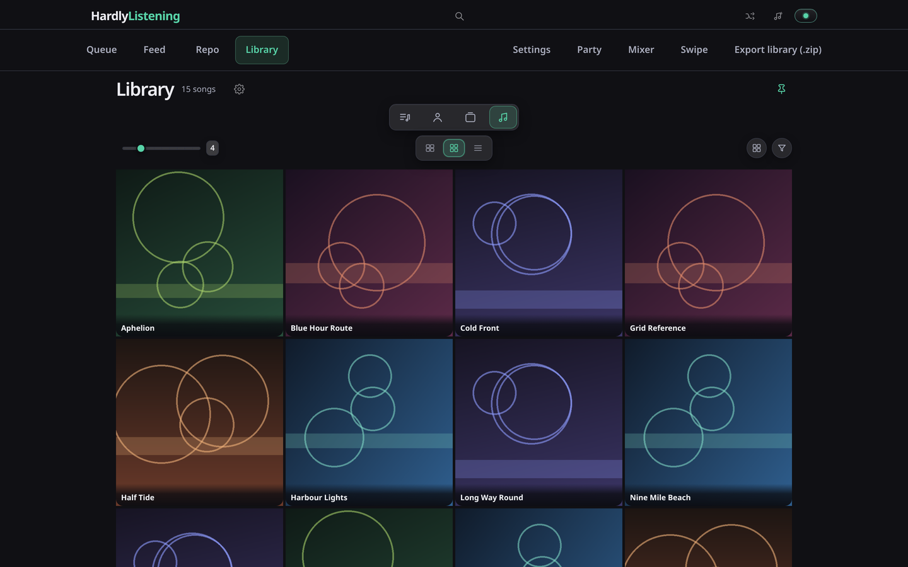
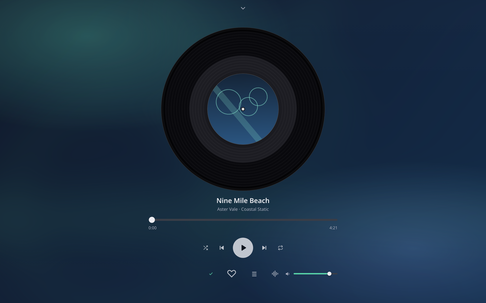
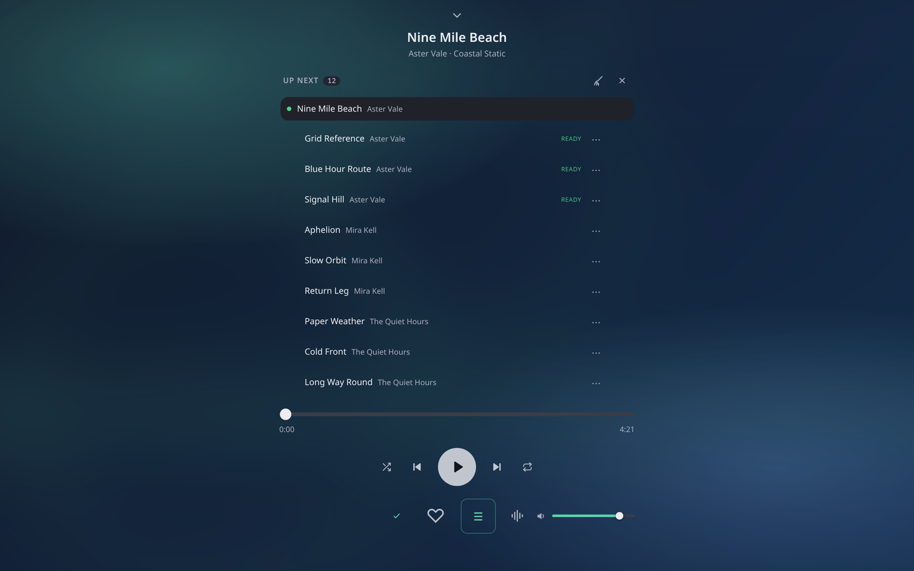

# HardlyListening

Paste a playlist, get every track on disk.

Built off the part of [HardlyWatching](../hardlywatching) that already drives
`yt-dlp` — one SQLite database, one worker thread, one honest pace — with the
Instagram machinery left behind.

<p>
  
</p>
<p>
  
  
</p>

The screenshots are a throwaway instance with invented songs and generated
artwork — no real library appears in them.

## What it takes

* **SoundCloud** — sets and user pages, read natively by yt-dlp.
* **Apple Music** — public playlists, albums and single songs
  (`music.apple.com/…/playlist/…`). Apple has no yt-dlp extractor, so the
  tracklist is read from the page and each track is *matched* on SoundCloud
  first, YouTube second. A match is scored — remixes, covers, sped-up and live
  versions are penalised — and anything below 45% is refused rather than saved
  under the wrong name. A weak match is flagged with a percentage and can be
  re-pointed at any URL by hand.
* Anything else yt-dlp understands (Bandcamp albums, YouTube playlists, a single
  track URL).

## Library and Repository

Two scopes over the one database:

* **Repository** is the shared pool: every track whose file is on disk, for everyone on
  the instance.
* **Library** is yours: the songs and playlists you saved, plus personal folders you can
  nest.

Both browse five ways — **songs, albums, artists, playlists, folders** — with search,
sort and sort direction, a column slider (1–8) and three layouts: cards, covers only,
and list. A card's save button adds the song or album in one click. Every song, album
and playlist carries upvote/downvote counts and a discussion thread, and the pinned
carousel at the top is per member.

`Export library (.zip)` writes your saved songs as a ZIP with an `.m3u8` inside whose
paths are relative to the archive, so the unzipped folder works anywhere. The same
catalogue is also served over the Subsonic / OpenSubsonic API, scoped to one device's
member, so a phone player can stream it. The transcoding extension is answered honestly:
a client whose direct-play profile accepts the stored file gets those exact bytes with
HTTP Range seeking, and a client that would need a re-encode is told so. The parts
Subsonic has and this app does not (chat, jukebox, re-encoding, sonic analysis, podcast
downloads, user administration) answer Subsonic error 30 rather than pretending.

## The player

One audio element drives the bar, the fullscreen view and the queue, so there is no
second player to drift out of sync.

* **The bar** keeps like, the library save control, artwork, title, transport, shuffle
  and repeat, mute, a volume fader and the lyrics button. Click the title or the expand
  button for fullscreen.
* **Fullscreen** turns the artwork into a record you can drag to scrub, then title,
  artist and album, a seek bar with both times, and one foot row: library save, like,
  play queue, visualizer style and volume. The volume fader is desktop only — a phone
  has hardware buttons and its single column has no spare lane.
* **The play queue** is the same element on both surfaces: it is physically moved into
  the fullscreen column rather than floated over it, so the page rearranges around it
  instead of being covered. Rows drag to reorder — press and hold on a phone, grab the
  handle with a mouse — and a lifted row owns the gesture, so the list cannot scroll
  out from under the drag. `⋯` moves a row to the top or the bottom, or removes it.
* **Saving is a two-step remove.** A song in your library shows a check. The first click
  turns it into a minus; only the second click removes it, so a stray tap on a card
  cannot delete a song. The armed minus lets go after four seconds, on Escape, or on a
  click anywhere else, and only one control is armed at a time.
* **The visualizer** has five styles with live knobs (bar density, smoothing, mirror,
  glow). It shares a column with the queue, so opening one closes the other.
* **Where you left off** is remembered — queue, current song and position — and comes
  back paused, because a browser will not start audio on its own.
* **Offline audio** (user menu → Offline audio…) keeps a song that has played, whole, in
  the service worker's cache, so playing it again starts from disk. The budget is per device
  (off, 1, 2, 5 or 10 GB), the oldest copy is dropped first, and *Remove copies* empties it.
  The worker answers the element's Range requests with 206 slices of the stored file, which is
  what lets seeking work without the network. A browser may evict the whole cache when its
  storage runs short — that is the browser's rule, not the app's.

Both volume faders (bar and fullscreen) are painted from the audio element rather than
from each other, so they cannot disagree: muting empties both fills, and dragging either
fader clears the mute without losing the level.

## Lyrics and karaoke display

The player's **Lyrics** button opens standard lyrics with current-line LRC
highlighting. **Karaoke view** shows a large current/next line, and **Fullscreen**
uses browser fullscreen where supported. Seeking and playback-rate changes follow
the one existing audio element; opening lyrics never starts playback. Closing
aborts pending requests and removes all lyric playback listeners; no animation
loop or background polling is added. Reduced motion is respected.

`GET /api/track/<id>/lyrics` always requires approved browser membership, even
in local auth-disabled mode (30 requests/member/minute). It first reads a UTF-8
`.lrc` next to canonical local audio; resolved sidecar paths must remain inside
the configured root, including symlinks. Otherwise it makes a bounded,
8-second metadata-only request to LRCLIB: artist/title/album/duration, never audio,
acquisition URLs, credentials or local paths. Matching requires normalized exact
artist/title and supplied album, plus duration within three seconds when known.
Strict matching can intentionally miss editions or differently tagged albums.
An additive `lyrics_cache` table keys metadata, caches results for 24 hours, and
retries unavailable responses after one minute. Local sidecars are re-read on open.

Responses distinguish `synced`, `plain`, `instrumental`, `not_found` and
`unavailable`; plain lyrics never pretend to have synchronized timing. LRC
supports repeated timestamps, fractional seconds and millisecond offsets
(positive offsets display earlier). This is **line timing, not word timing**.
Instrumental is a provider annotation, not audio analysis. There is no vocal
removal, generated instrumental, lyric editor or automatic transcription.
Coverage and timing depend on the sidecar/provider; fullscreen support varies.

Verification: `python3 -m unittest discover -s tests -v` and
`node tests/test_lyrics_ui.cjs` (jsdom on `NODE_PATH`). Tests use isolated SQLite,
mock provider responses and DOM/media stubs; no live DB/media writes or audible
playback. Source changes require normal reviewed deployment, not an automatic
service restart.

## Running it

```sh
./install-service.sh       # systemd user service, autostart on, port 8470
./start.sh                 # or run it in the foreground
./install-service.sh remove
```

Needs `yt-dlp` and `ffmpeg` on PATH. The service listens on `0.0.0.0:8470` and
requires browser sign-in (see Accounts).

## Accounts

There is no public sign-up. Two links do the work:

* A **personal login link** (`/auth/link#invite=…`) is the account. It never
  expires until it is regenerated, it signs in on every device, and it is the
  way back in if a password is lost.
* A **signup link** (`/signup#invite=…`) is an invitation. It creates the member
  on first use, works exactly once and expires after seven days. Only its hash
  is stored, so it is shown once and never again. Members hold one outstanding
  signup link at a time; administrators mint as many as they need.

Signing up or signing in mints the same `__Host-hl_session` cookie, and
`members.id` is the identity behind playlists, saves, quota and Party whichever
method was used. Passwords are `scrypt` with a per-member salt and a minimum of
ten characters; a wrong password and an unknown email answer the same way. A
session opened through the login link can set a new password without the old
one — that link is the recovery path — while password sessions must confirm it.
Changing a password never revokes the login link. Google and Apple sign-in are
not implemented.

## The queue

* One worker, tracks in playlist order. Pacing between tracks is a setting
  (default 5 s) — that is cheaper than getting rate limited.
* Each track gets 4 tries: 1 min, 5 min, 20 min backoff. A *permanent* error
  (video removed, unsupported URL, no space) fails immediately instead of
  churning.
* A **rate limit** (429, "Sign in to confirm you're not a bot", 403) stops the
  whole queue for 15 minutes and keeps the track's place. The deadline is stored
  in the database, so restarting the app cannot bypass it. `Resume now` clears it.
* An **unusable source** (DRM-protected SoundCloud upload, geo-block) is not the
  track's fault: that candidate is remembered, dropped, and the next one tried —
  the next SoundCloud hit, then YouTube. No attempt is burned. A track that runs
  out of candidates fails honestly, and `Source` pins it to a URL by hand.
* Restarting mid-download re-queues the interrupted track. `archive.txt` in the
  download root means nothing already fetched is fetched twice.
* Files land exactly once: `<root>/<Artist>/<Collection>/NN - Title.mp3`, with
  tags and cover art. `Collection` is the album when the provider knows one,
  otherwise the playlist that first brought the track in. Adding the same track
  to a second playlist adds membership, not a second copy of the audio.

## Feed

Following an artist — from their page or the feed's own search — turns their new tracks
into **feed items** and nothing else. A feed item is expanded and queued only when you
click it; ignoring one keeps it ignored, and "new" is a seen-set rather than a timestamp,
so a pinned or re-ordered provider listing cannot flood the feed.

## Party, Swipe, and the other pages

* `/party` — a room that outlives any one browser tab. Members create it, guests join
  through a 24-hour guest link that never becomes an account and can never touch the
  normal API. The shared queue ranks by votes, the current track can be skipped once
  more than half the people present agree (a room of one skips instantly), chat keeps
  the last 500 messages, and one member holds a 30-second host lease to advance playback.
* `/swipe` — one Repository song at a time: right adds it to your library, left drops
  it, up adds and likes it. Tap plays; the arrow keys do the same.
* `/dj` — the mixer, described below.

## Mixer (/dj)

A two-deck board that plays your own library, so the EQ and filters do real DSP:

    Deck A ─ trim ─ LOW ─ MID ─ HIGH ─ HPF/LPF sweep ─ channel ─ crossfader ─┐
                                                                             ├─ master ─ out
    Deck B ─ (same chain) ────────────────────────────────────────────────── ┘

* LOW / MID / HIGH are real biquads (150 Hz shelf, 1 kHz peak, 8 kHz shelf).
* FILTER is one knob: centre off, left sweeps a low-pass down, right sweeps a
  high-pass up.
* PITCH changes playback speed (and therefore key, exactly like a turntable).
* Record captures the master output to `.webm` via MediaRecorder.
* Click any control (or read the panel above the decks) for what it does, when to
  use it, and what to listen for; `Start the tour` walks through load → levels →
  crossfade → fixing a bass clash.

What it deliberately does not do, because a browser cannot:

* **No system-wide EQ.** It processes only audio this page plays. An EQ over
  every app on the machine is a PipeWire filter chain (EasyEffects already does
  it); a web page can never reach another process's audio.
* **No headphone cue.** Splitting one deck to a second output device needs the
  OS mixer, i.e. real DJ hardware or Mixxx.
* **No beat grid / sync.** There is no tempo analysis yet — the pitch fader is
  manual, and the readout is a speed multiplier, not a BPM.

## API

| endpoint | body | does |
|---|---|---|
| `GET /api/state` | | playlists, tracks, stats, log |
| `GET /api/library` | | every track that has a file on disk |
| `GET /api/track/<id>/audio` | | the file, with HTTP Range (seeking) |
| `POST /api/add` | `{url}` | expand + queue a playlist (newline-separated allowed) |
| `POST /api/pause` | `{on}` | pause / resume the queue |
| `POST /api/cooldown/clear` | | drop a rate-limit cooldown |
| `POST /api/track/<id>/retry` | | re-queue one track |
| `POST /api/track/<id>/skip` | | skip one track |
| `POST /api/track/<id>/source` | `{url}` | pin a track to an explicit URL (blank = re-search) |
| `POST /api/playlist/<id>/requeue` | | re-queue a whole playlist |
| `POST /api/playlist/<id>/remove` | `{delete_files}` | remove from the queue |
| `POST /api/failed/retry` | | re-queue every failed track |
| `POST /api/settings` | `{...}` | root, audio_format, pacing, max_attempts, cooldown, embed_thumb |

## Layout

```
db.py                  schema, settings, jobs, the /api/state snapshot
providers/base.py      Provider contract: identify / resolve / new_releases
providers/soundcloud.py  sets, tracks, artist pages (direct audio)
providers/apple_music.py playlists, albums, songs (metadata only)
providers/generic.py   anything else yt-dlp reads
downloaders/ytdlp.py   command building, search + scoring, error classification
engine/queue.py        one worker: retries, provider-wide 429 cooldown, pacing
library/store.py       the canonical path (Artist/Collection/NN - Title)
server.py              stdlib HTTP server + JSON API (no framework)
web/index.html         the main UI — plain DOM, polls /api/library
web/dj.html            the mixer board
web/party.js           the room client (queue, votes, chat, host lease)
web/swipe.js           one Repository card at a time
subsonic.py            Subsonic / OpenSubsonic surface for phone players
```

`download_jobs` holds the state of every track: `queued`, `resolving`,
`downloading`, `retry_wait`, `completed`, `failed`, `unavailable`, `cancelled`.
A track's status is its job's status — there is no second copy of it on the track
row. `watches` and `feed_items` back the Feed: a subscription writes items and
never downloads, and only a click turns one into a job.

## Tests

`python3 -m unittest discover -s tests -v` covers the server; the UI tests are
Playwright scripts that serve `web/` over a stub API and drive a headless browser:

```sh
node tests/test_library_save_control.cjs   # check → minus → remove
node tests/test_volume_faders.cjs          # bar and fullscreen fader stay in step
node tests/test_queue_reorder_touch.cjs    # drag a row on a touch screen
node tests/test_fullscreen_queue_toggle.cjs # open looks open, shut looks shut
node tests/visual/library.cjs              # library list, cards, and the playing row
node tests/visual/snap.cjs                 # every screen against tests/visual/baseline
```

Playwright is not vendored here. `tests/_pw.cjs` resolves it once for the visual tests: an
explicit `PW_PLAYWRIGHT`, a local install, then the shared one under `~/apps`. The other
scripts still expect it on `NODE_PATH`:

```sh
export NODE_PATH=/path/to/node_modules     # wherever playwright is installed
```

`snap.cjs --update` rewrites the baselines; look at every changed screenshot before
accepting one, because a diff outside the element you touched is a regression.
`library.cjs --update` does the same for the library baselines in `tests/visual/library/`.
